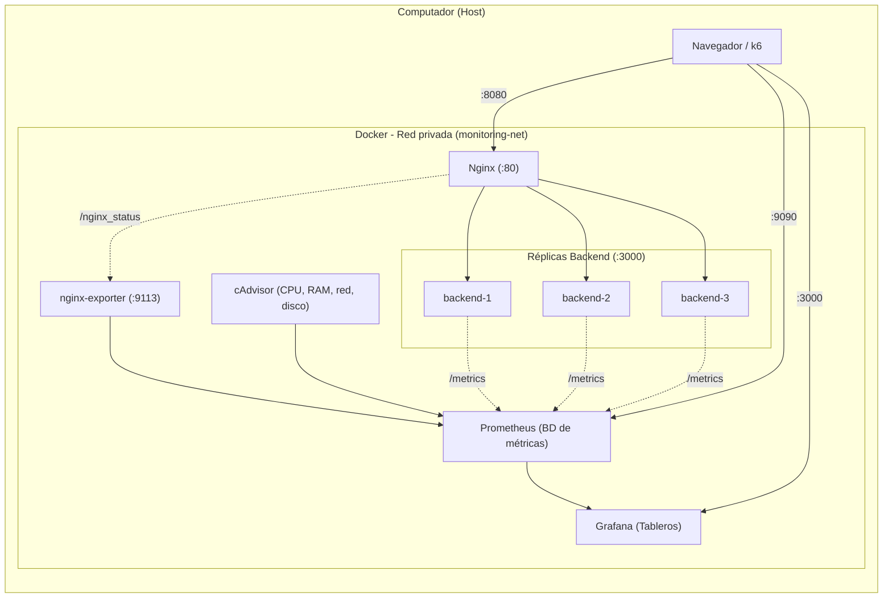

# Docker Monitoring Project

Stack de infraestructura y observabilidad con Docker Compose para una API de gestión de incidentes en NestJS balanceada con Nginx y monitoreada con Prometheus, cAdvisor, Nginx Exporter y Grafana.

## Prerrequisitos

- [Docker](https://docs.docker.com/get-docker/) y Docker Compose (`docker compose` o `docker-compose`).
- [k6](https://k6.io/docs/get-started/installation/) (opcional, para ejecutar pruebas de carga).
- `curl` para verificaciones rápidas desde la terminal.

## Arquitectura



Todos los servicios se comunican a través de la red bridge `monitoring-net`. Prometheus y Grafana persisten sus datos en los volúmenes `prometheus_data` y `grafana_data`.

## Configuración inicial (`.env`)

Antes de levantar los contenedores, copie el archivo de ejemplo de variables de entorno:

```bash
cp .env.example .env
```

Puede ajustar en `.env` los puertos expuestos (`NGINX_PORT`, `PROMETHEUS_PORT`, `GRAFANA_PORT`) y las credenciales de Grafana (`GF_SECURITY_ADMIN_USER`, `GF_SECURITY_ADMIN_PASSWORD`).

## Levantar el stack

Con Docker Compose v2:

```bash
docker compose up -d --build
```

Si utiliza Docker Compose v1 (`docker-compose`):

```bash
docker-compose up -d --build
```

Verifique que todos los servicios estén en estado `running` / `healthy`:

```bash
docker compose ps
```

## URLs de acceso

- **API (vía Nginx Load Balancer):** `http://localhost:8080`
- **Prometheus:** `http://localhost:9090`
- **Grafana:** `http://localhost:3000` (usuario/contraseña por defecto: `admin` / `admin`)

## Verificación de balanceo de carga

Realice varias peticiones consecutivas al endpoint raíz de la API para comprobar el balanceo round-robin entre `backend-1`, `backend-2` y `backend-3`:

```bash
for i in {1..6}; do curl -s http://localhost:8080/ && echo ""; done
```

Cada respuesta incluirá el campo `instanceId` rotando entre las tres réplicas.

## Verificación de métricas y Grafana

1. **Targets en Prometheus:** ingrese a `http://localhost:9090/targets` y confirme que los jobs `prometheus`, `backend` (3 instancias), `nginx-exporter` y `cadvisor` aparezcan en estado **UP**.
2. **Dashboards en Grafana:** ingrese a `http://localhost:3000`, diríjase a **Dashboards** y verifique los tres tableros aprovisionados automáticamente:
   - **Incident API - Overview** (`overview.json`): estado de targets, tasa de peticiones por instancia, latencia p95, códigos HTTP y peticiones en curso.
   - **Docker Containers (cAdvisor)** (`containers.json`): uso de CPU, memoria y red RX/TX por contenedor.
   - **Nginx Load Balancer** (`nginx.json`): conexiones activas, aceptadas/atendidas y peticiones por segundo.

## Pruebas de carga con k6

Con el stack en ejecución, lance el script de prueba contra `http://localhost:8080`:

```bash
k6 run tests/load-test.js
```

El script ejecuta peticiones `GET /`, `POST /incidents` y `GET /incidents` con validaciones (`checks`) y umbrales (`thresholds`) de tasa de error `< 1%` y latencia `p(95) < 500ms`.

## Apagado y limpieza

Para detener y eliminar los contenedores manteniendo los volúmenes de datos:

```bash
docker compose down
```

Para eliminar también los volúmenes (`prometheus_data` y `grafana_data`):

```bash
docker compose down -v
```

---

## Resumen rápido para la demo

- **Docker y Docker Compose:** Empaquetan cada parte del sistema en contenedores aislados y los levantan todos juntos en una red privada (`monitoring-net`) con un solo comando.
- **Backend (NestJS, 3 réplicas):** Es la API de incidentes (`backend-1`, `backend-2`, `backend-3`). Cada copia atiende peticiones, devuelve su `instanceId` y expone sus métricas en `/metrics`.
- **Nginx:** Actúa como proxy inverso y balanceador de carga. Recibe todo el tráfico en el puerto `8080` y lo reparte por turnos (*round-robin*) entre las 3 réplicas del backend.
- **Nginx Prometheus Exporter:** Lee las estadísticas internas de Nginx (`/nginx_status`) y las traduce a un formato que Prometheus entiende.
- **cAdvisor:** Vigila los contenedores a nivel de infraestructura: mide cuánto CPU, memoria RAM, red y disco consume cada uno.
- **Prometheus:** Es el recolector y base de datos de métricas. Cada 15 segundos consulta al backend, al exportador de Nginx y a cAdvisor para guardar el historial.
- **Grafana:** Toma los datos guardados en Prometheus y los muestra en tableros visuales en tiempo real (tráfico por instancia, latencia, errores y uso de recursos).
- **k6:** Es la herramienta de pruebas de carga (`tests/load-test.js`). Simula hasta 25 usuarios simultáneos pegándole a Nginx para comprobar que el balanceo funciona y que los tiempos de respuesta se mantienen bajos.

```bash
docker run --rm -i grafana/k6 run -e BASE_URL=http://host.docker.internal:8080 - < tests/load-test.js
```

**Grafana**
http://localhost:3000/d/incident-api-overview/incident-api-overview?from=now-15m&to=now&timezone=browser&refresh=5s

Para ingresar solo es:
- correo: `admin`
- pass: `admin`

Luego para ver métricas ir a **Incident API - Overview**.

**Prometheus**
http://localhost:9090/graph?g0.expr=&g0.tab=1&g0.display_mode=lines&g0.show_exemplars=0&g0.range_input=1h

- `up` (muestra los 6 servicios activos)
- `rate(http_requests_total[1m])` (peticiones por segundo en cada réplica)
- `nginx_http_requests_total` (total de peticiones atendidas por Nginx)

**Backend:**
http://localhost:8080/

### Interpretación de los resultados en Grafana (`Incident API - Overview`)

Al ejecutar la prueba de carga con `k6`, el tablero principal refleja el comportamiento esperado del sistema:

| Panel | Qué observar | Significado |
| :--- | :--- | :--- |
| **Targets UP** | Los 6 servicios (`backend-1`, `backend-2`, `backend-3`, `cadvisor`, `prometheus` y `nginx-exporter`) en estado **UP** (verde). | Todos los objetivos están activos y siendo recolectados correctamente por Prometheus. |
| **Request Rate per Instance** | Las 3 líneas (`backend-1`, `backend-2` y `backend-3`) suben juntas hasta ~25 req/s cada una. | Demuestra visualmente que Nginx distribuye la carga de manera uniforme (*round-robin*). |
| **p95 Latency** | La latencia bajo carga se mantiene alrededor de **~5 ms**. | El sistema responde con holgura, muy por debajo del umbral de 500 ms definido en `k6`. |
| **HTTP Status Codes** | Únicamente respuestas exitosas (**HTTP 200** y **HTTP 201**). | Sin errores de servidor ni peticiones fallidas durante la prueba de carga. |
